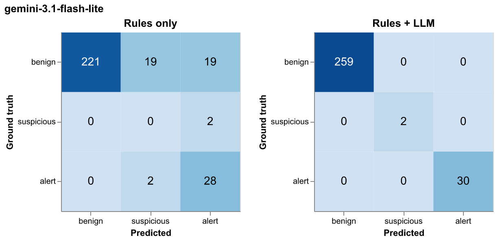

# Evaluation report

Generated 2026-10-21 04:57 by `evaluate.py` from `outputs/runs/`.

## 1. Setup

- Transactions: 291 across 5 users (2024-07-01 to 2024-10-31).
- Ground truth: benign = 259, suspicious = 2, alert = 30.
- Ground-truth alert types: unusual_spending (12), exploitation_escalating_transfers (6), money_mule_inflow (6), money_mule_outflow (6), unusual_transfer (2).
- Models evaluated: `gemini-3.1-flash-lite`.
- Two stages are scored for every model: **Rules only** (the rule label before the LLM) and **Rules + LLM** (the final label after validation). The rules do not use the LLM, so their numbers only differ between runs through the counterparty extraction.
- Final label mapping: LLM risk `high` -> alert, `medium` -> suspicious, `low` -> benign; confidence below the threshold -> suspicious + human review; LLM failure -> rule label + review.

Positive class for the binary metrics: **flagged** = `suspicious` or `alert`. The **alert** metrics only count the `alert` class, which is what would notify a trusted contact.

**Read the numbers with caution.** There is no held-out set: the rule thresholds were chosen with `check_rules.py` against these same labels, and the prompts were written after exploring these same users. With 32 positives from 3 incidents, one more or one fewer error moves recall by about 3 points. The metrics show that the design works on the patterns in this dataset, not how it generalizes.

## 2. Classification metrics

| model | stage | accuracy | macro F1 | flagged P | flagged R | flagged F1 | alert P | alert R | alert F1 |
|---|---|---|---|---|---|---|---|---|---|
| gemini-3.1-flash-lite | Rules only | 0.86 | 0.54 | 0.46 | 1.00 | 0.63 | 0.57 | 0.93 | 0.71 |
| gemini-3.1-flash-lite | Rules + LLM | 1.00 | 1.00 | 1.00 | 1.00 | 1.00 | 1.00 | 1.00 | 1.00 |

### gemini-3.1-flash-lite

**Rules only** - confusion matrix

| true \ predicted | benign | suspicious | alert |
|---|---|---|---|
| benign | 221 | 19 | 19 |
| suspicious | 0 | 0 | 2 |
| alert | 0 | 2 | 28 |

**Rules only** - per class

| class | precision | recall | f1 | support |
|---|---|---|---|---|
| benign | 1.00 | 0.85 | 0.92 | 259 |
| suspicious | 0.00 | 0.00 | 0.00 | 2 |
| alert | 0.57 | 0.93 | 0.71 | 30 |

**Rules + LLM** - confusion matrix

| true \ predicted | benign | suspicious | alert |
|---|---|---|---|
| benign | 259 | 0 | 0 |
| suspicious | 0 | 2 | 0 |
| alert | 0 | 0 | 30 |

**Rules + LLM** - per class

| class | precision | recall | f1 | support |
|---|---|---|---|---|
| benign | 1.00 | 1.00 | 1.00 | 259 |
| suspicious | 1.00 | 1.00 | 1.00 | 2 |
| alert | 1.00 | 1.00 | 1.00 | 30 |

**Recall by ground-truth alert type** (share of each type that ends flagged / ends as alert)

| alert_type | n | rules_flagged | final_flagged | final_alert |
|---|---|---|---|---|
| exploitation_escalating_transfers | 6 | 1.00 | 1.00 | 1.00 |
| money_mule_inflow | 6 | 1.00 | 1.00 | 1.00 |
| money_mule_outflow | 6 | 1.00 | 1.00 | 1.00 |
| unusual_spending | 12 | 1.00 | 1.00 | 1.00 |
| unusual_transfer | 2 | 1.00 | 1.00 | 0.00 |

**User level** (does the user get at least one alert?) - accuracy 100%

| user_id | should_alert | alerted | true_alerts | predicted_alerts |
|---|---|---|---|---|
| USR-001 | True | True | 6 | 6 |
| USR-002 | False | False | 0 | 0 |
| USR-003 | True | True | 12 | 12 |
| USR-004 | False | False | 0 | 0 |
| USR-005 | True | True | 12 | 12 |

## 3. Error analysis

### gemini-3.1-flash-lite

- The rules flagged 70 transactions: 32 true positives and 38 false positives; they missed 0 positives.
- The LLM cleared 38 of the 38 rule false positives (100%) and wrongly dismissed 0 of the 32 rule true positives (0%).
- Sent to human review: 0 (decision sources: {'rules': 221, 'llm': 70}).

**False negatives (0)**

None.

**False positives (0)**

None.

**LLM confidence vs. correctness** (flag / no-flag decision on validated transactions)

| bucket | n | accuracy |
|---|---|---|
| (0.6, 0.8] | 6 | 1.00 |
| (0.8, 0.9] | 7 | 1.00 |
| (0.9, 1.0] | 57 | 1.00 |

## 4. Model comparison

Latency is measured per validation call (API time, excluding backoff sleeps). Cached calls keep the tokens and latency of the original call, so re-runs do not distort the comparison; wall time does reflect caching.

| model | flagged F1 | alert F1 | alert recall | alert precision | LLM calls | failed | retried | latency p50 (s) | latency p95 (s) | input tok | output tok | thinking tok | run cost | wall time (s) |
|---|---|---|---|---|---|---|---|---|---|---|---|---|---|---|
| gemini-3.1-flash-lite | 1.000 | 1.000 | 1.000 | 1.000 | 94 | 0 | 5 | 2.579 | 17.690 | 146932 | 18467 | 0 | 0.064 | 247.600 |

## 5. Cost projection

Cost per transaction = total LLM cost of the run / transactions processed, so it already includes the share of transactions that never reach the LLM. Extraction is cached per unique description, so its cost per transaction falls as volume grows (descriptions repeat). Prices from https://ai.google.dev/gemini-api/docs/pricing (standard tier).

| model | price in/out per 1M | extraction cost / call | validation cost / call | flag rate | cost / transaction | monthly (50,000 tx) |
|---|---|---|---|---|---|---|
| gemini-3.1-flash-lite | $0.25 / $1.5 | $0.0001 | $0.0009 | 24% | $0.0002 | $11.07 |

**Sensitivity to the rule flag rate** (validation is the dominant cost and scales with how many transactions the rules flag):

| model | flag rate | monthly cost (50,000 tx) |
|---|---|---|
| gemini-3.1-flash-lite | 5% | $2.79 |
| gemini-3.1-flash-lite | 10% | $4.96 |
| gemini-3.1-flash-lite | 25% | $11.48 |
| gemini-3.1-flash-lite | 24% | $11.07 |

Where to optimize: 13 validations (19% of all validations) come from transactions flagged **only** by the weekly-overspend rule, and the LLM clears 62% of them (`gemini-3.1-flash-lite`). Validating one week per user (instead of each debit) or pre-filtering routine merchants would cut most of that spend.
